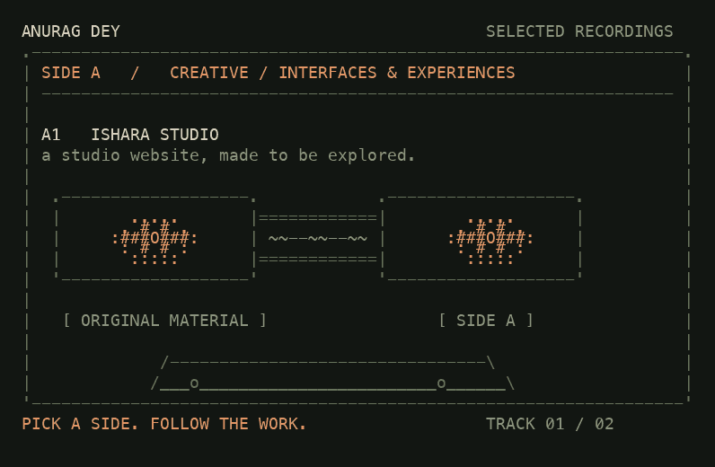

# Side A / Creative

Interfaces, motion, and the experience of using something.

<a href="./TECHNICAL.md">
  <picture>
    <source media="(prefers-reduced-motion: reduce)" srcset="./assets/side-a-still.png" />
    
  </picture>
</a>

<pre>
  [ <a href="./README.md">EJECT / PROFILE</a> ]        [ <a href="./TECHNICAL.md">FLIP / SIDE B</a> ]
</pre>

## A1 / Ishara Studio

A design-studio website with animated sections, a filterable work archive, and project case-study views. Built with JavaScript, CSS, Vite, and GSAP.

**Inside the build:** shared design tokens, responsive motion with reduced-motion alternatives, JSON-driven project content, and an editor loaded on demand.

[Visit the website](https://isharaastudio.com/)

## A2 / airn't

An interactive air-quality application built with React and TypeScript. It presents live PM2.5 data through visual exposure estimates, city comparisons, forecasts, and shareable receipts.

**Inside the build:** air-quality API integration, exposure controls, interactive charts, and a custom visual interface.

[Live demo](https://airn-t.vercel.app/) · [Source](https://github.com/anuragdey05/airn-t)

---

[Flip to Side B: systems and models](./TECHNICAL.md) · [Back to profile](./README.md) · [Still tape](./assets/side-a-still.png)
