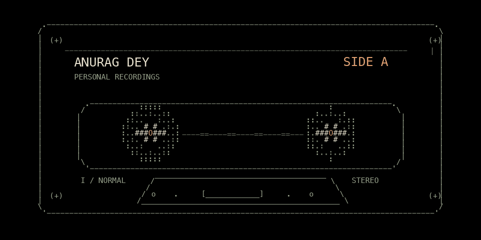

A creative working at the intersection of web, finance, engineering, and AI.

<a href="https://open.spotify.com/playlist/6ehfQCEAurnAGWjCpe0Zpl">
  <picture>
    <source media="(prefers-reduced-motion: reduce)" srcset="./assets/cassette-dark-still.png" />
    
  </picture>
</a>

<a href="https://open.spotify.com/playlist/6ehfQCEAurnAGWjCpe0Zpl">A tape for the background.</a>

### Selected work

- **[Ishara Studio](https://isharaastudio.com/)** — creative web and interaction design.
- **[airn't](https://github.com/anuragdey05/airn-t)** — environmental data meets visual storytelling. [Live](https://airn-t.vercel.app/)
- **[SPAN Margin Calculator](https://github.com/anuragdey05/span-margin-calculator)** — finance meets engineering. Bullero Capital internship, 2025.
- **[AUEC Voting Portal](https://github.com/anuragdey05/auec-voting-portal)** — election systems and auditability.
- **[ArtEmis Captioning](https://github.com/anuragdey05/Image-Caption-Generator)** — machine learning meets art.
