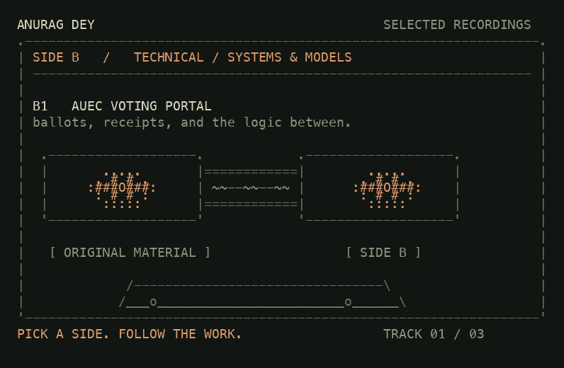

# Side B / Technical

The systems, data, and models underneath.

<a href="./CREATIVE.md">
  <picture>
    <source media="(prefers-reduced-motion: reduce)" srcset="./assets/side-b-still.png" />
    
  </picture>
</a>

<pre>
  [ <a href="./README.md">EJECT / PROFILE</a> ]        [ <a href="./CREATIVE.md">FLIP / SIDE A</a> ]
</pre>

## B1 / AUEC Voting Portal

A student-election application built with Python and Django. The ballot submission flow uses database transactions and row locks, validates multi-candidate and NOTA ballots, and produces receipts and a hash-chained audit ledger.

**Inside the build:** voter eligibility, single-use voting tokens, ballot validation, audit exports, and tests for receipt chains and ledger structure.

[Source](https://github.com/anuragdey05/auec-voting-portal) · [Ballot logic](https://github.com/anuragdey05/auec-voting-portal/blob/main/voting/services.py) · [Tests](https://github.com/anuragdey05/auec-voting-portal/blob/main/voting/tests.py)

## B2 / SPAN Margin Calculator

A Python project from my 2025 Bullero Capital internship, built to calculate derivatives-portfolio margin requirements from SPAN risk files, exposure-rate CSVs, and Redis-backed price data.

**Inside the build:** XML parsing, aggregation across 16 risk scenarios, calendar-spread charges, net option value, and individual versus combined portfolio margins.

[Source & methodology](https://github.com/anuragdey05/span-margin-calculator) · [Calculation engine](https://github.com/anuragdey05/span-margin-calculator/blob/main/margin_calculator/margin_calculator.py)

## B3 / ArtEmis Image Captioning

An image-captioning project using WikiArt paintings and ArtEmis annotations. It implements two approaches in PyTorch: a custom CNN with an LSTM decoder, and a Vision Transformer with an autoregressive Transformer decoder.

**Inside the build:** shared tokenization and vocabulary, image preprocessing, cross-attention, training scripts, and a notebook for training and evaluation.

[Source](https://github.com/anuragdey05/Image-Caption-Generator) · [Training notebook](https://github.com/anuragdey05/Image-Caption-Generator/blob/main/ArtEmis_Caption_Generation.ipynb) · [Transformer implementation](https://github.com/anuragdey05/Image-Caption-Generator/tree/main/src/models/vit)

---

[Flip to Side A: interfaces and experiences](./CREATIVE.md) · [Back to profile](./README.md) · [Still tape](./assets/side-b-still.png)
